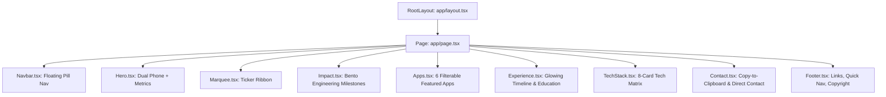

# Portfolio Architecture & Engineering Guide

This document details the architectural structure, design decisions, data flow, and component relationships in Javid Akeel's modern portfolio website.

---

## 1. High-Level Overview

- **Framework**: Next.js 15 (App Router with React 19)
- **Styling**: Tailwind CSS v4 with custom CSS variable tokens, Google Fonts (`Bricolage Grotesque`, `Inter`, `JetBrains Mono`), and bespoke keyframe animations (`floaty`, `flow`, `marquee-h`).
- **Icons**: `lucide-react`
- **Routing**: Next.js App Router
  - `/`: Main single-page interactive showcase (Hero, Impact, Apps, Experience, Tech Stack, Contact).
  - `/resume`: Dedicated interactive CV & embedded PDF viewer/downloader page.

---

## 2. Directory Structure

```
├── app/
│   ├── favicon.ico
│   ├── globals.css         # Design tokens, custom animations, utility classes
│   ├── layout.tsx          # Root layout with metadata and font configurations
│   ├── page.tsx            # Single-page portfolio orchestration
│   └── resume/
│       └── page.tsx        # Resume viewer with PDF embed, printer & interactive CV
├── components/
│   ├── Apps.tsx            # Categorized production app showcase cards
│   ├── Contact.tsx         # Email copy utility, social links, direct contact CTA
│   ├── Experience.tsx      # Vertical timeline, career trajectory & education
│   ├── Footer.tsx          # Footer with back-to-top anchor and status badges
│   ├── Hero.tsx            # Primary hook, dual phone preview, metrics & live pipeline
│   ├── Impact.tsx          # Engineering highlights (75% FFmpeg reduction, 60 FPS feed, etc.)
│   ├── Marquee.tsx         # Continuous infinite-scrolling tech ribbon
│   ├── Navbar.tsx          # Floating pill navigation with intersection observer
│   └── TechStack.tsx       # 8-card bento grid categorizing core proficiencies
├── docs/
│   ├── APP_LINKS.md        # App store links, package IDs, and app summaries
│   ├── ARCHITECTURE.md     # This document
│   ├── DESIGN_SYSTEM.md    # Color palette, typography, tokens, animations
│   ├── FUTURE_FIXES_AND_RUNBOOK.md # Maintenance runbook and troubleshooting
│   └── reference/          # Reference build scripts from design prototype
├── public/
│   ├── avatar.png          # High-res profile portrait
│   ├── icons/              # Verified application icons (Selfitoons, Bizstack, Ubill, etc.)
│   ├── shots/              # Production UI mockups and app screenshots
│   └── Javid_Akeel_Resume.pdf # Optimized resume PDF for viewing/download
├── .gitignore              # Configured ignore list for archives, staging & caches
├── next.config.ts          # Next.js build and image optimization settings
├── package.json            # Project dependencies and script runner
└── tsconfig.json           # TypeScript configuration
```

---

## 3. Component Hierarchy (`app/page.tsx`)

The main page (`/`) renders a vertical single-page portfolio designed for high narrative engagement:



### Component Breakdown
1. **`Navbar`** (`components/Navbar.tsx`)
   - Uses `useEffect` with scroll event listeners to track active viewport sections (`apps`, `impact`, `experience`, `tech`, `contact`).
   - Sticky floating glass container with blurred backdrop (`rgba(11,13,18,0.7)`).
   - Direct button link to `/resume` and "Hire me" smooth scroll.

2. **`Hero`** (`components/Hero.tsx`)
   - Split layout: punchy copy on the left, dual floating 3D phone mockups on the right.
   - Shows real-time interactive preview of **Selfitoons** (cartoon generation pipeline) and **Internsharks** (reels feed).
   - Real-time pipeline processing card showing step-by-step cartoonization (Upload -> Gemini -> Stable Diffusion -> Export).

3. **`Impact`** (`components/Impact.tsx`)
   - Bento grid spotlighting hard engineering metrics:
     - **~75% Server Cost Reduction**: Native on-device FFmpeg video concatenation vs server rendering.
     - **5+ Commercial App Store Releases**: Flutter, Native Android, and iOS deployments.
     - **650+ Active Businesses**: Migration of Ubill desktop to Flutter cross-platform architecture.
     - **60 FPS Video Feed**: Custom Controller Pooling with zero memory leakage.

4. **`Apps`** (`components/Apps.tsx`)
   - Interactive filtering categories: `All`, `AI`, `Billing & POS`, `Community`.
   - Displays 6 production apps:
     1. **Selfitoons** (Generative AI Cartoonizer)
     2. **Internsharks** (Internship Video Reels Platform)
     3. **Fulupo Store** (Merchant E-Commerce & Inventory)
     4. **Ubill Billing & Inventory** (Offline-first POS)
     5. **Bizstack POS** (Restaurant & Retail Point-of-Sale)
     6. **Marine Ninja** (Marine Technical Forum & Community)
   - Store buttons linking to verified Play Store, App Store, and Web deployment links.

5. **`Experience`** (`components/Experience.tsx`)
   - Clean vertical timeline connected by an electric gradient track (`lime` to `cyan` to `violet`).
   - Features Javid's key roles: **Software Engineer at Selfitoons**, **Mobile App Developer at Redjinni**, and **Freelance Full-Stack Developer**.
   - Includes education card: B.E. in Electronics & Communication Engineering.

6. **`TechStack`** (`components/TechStack.tsx`)
   - 8-card bento grid organizing languages, frameworks, AI/ML models, cloud services, and storage systems into categorized chips.

7. **`Contact`** (`components/Contact.tsx`)
   - Instant copy-to-clipboard functionality for `workwithakeel@gmail.com` with a live visual toast state.
   - Social connect buttons for LinkedIn, GitHub, and Resume.

---

## 4. Resume Architecture (`app/resume/page.tsx`)

The `/resume` route serves two purposes:
1. **Interactive Web CV**: A responsive, cleanly styled online version of Javid's resume with live links and structured sections.
2. **Document Viewer & Downloader**:
   - Direct embedded PDF viewer using `<object>` and `<iframe>` fallback pointing to `/Javid_Akeel_Resume.pdf`.
   - "Download PDF" button triggering an explicit download attribute.
   - "Print" action invoking `window.print()` with `@media print` optimized CSS.

---

## 5. State Management & Interaction Patterns

- **No bulky third-party state managers needed**: State is kept local and lightweight using React `useState`, `useEffect`, and standard DOM APIs.
- **Scroll Spy**: Implemented in `Navbar.tsx` via `window.scrollY` offset calculation against element IDs.
- **Clipboard Management**: Uses `navigator.clipboard.writeText()` with a 2.5s timer reset for the copy indicator.
- **Animations**: Driven natively by CSS transforms and keyframes (`floaty`, `flow`, `marquee-h`) to ensure butter-smooth 60-120 FPS performance on all hardware without dragging the JavaScript event loop.
